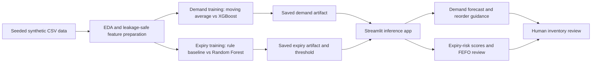

# PharmaStock AI

PharmaStock AI is a reproducible, synthetic-data decision-support prototype for 30-day medicine demand forecasting, batch expiry-risk flagging and stock replenishment review. It is an AI/ML assignment demonstration, not a production pharmacy system or medication advice tool. A human must review every alert.

## What is included

- Reproducible synthetic data generation in `src/data_generator.py` and `src/expiry_dataset_generator.py` (seed 42).
- EDA and demand/expiry training notebooks in `notebooks/`.
- Saved XGBoost demand and Random Forest expiry-risk artifacts in `models/`.
- A Streamlit inference dashboard that loads those saved artifacts and computes live predictions from the included CSV data.
- FEFO batch ordering and reorder-point/safety-stock guidance in `src/inventory_optimizer.py`.
- Inference and business-logic checks in `tests/`.

## Architecture



All datasets are generated locally; there is no external data license. Expiry outcomes are simulated, and no real pharmacy, patient or personal data is included. The included batch file has initial batch quantities, not time-varying on-hand quantities. The dashboard proportionally allocates product-level stock to batches as an explicit demo assumption.

## Environment and run

Python 3.10 or 3.11 is recommended. From the repository root:

```powershell
python -m venv .venv
.\.venv\Scripts\Activate.ps1
python -m pip install -r requirements.txt
python src/data_generator.py
python src/expiry_dataset_generator.py
```

The notebooks document the original model training sequence. To open them, run `jupyter lab` and execute notebooks `01` through `05` in order. The currently committed model files and metrics are the artifacts from the completed run; regenerating data requires rerunning the corresponding notebooks to keep models and data aligned.

Launch the inference interface:

```powershell
streamlit run app/dashboard.py
```

Run the included checks:

```powershell
pytest -q
```

## Problem definitions

| Module | Prediction unit | Target/horizon | Prediction time | Evaluation |
|---|---|---|---|---|
| Demand | Product and forecast origin | Total units sold over the next 30 days | End of latest available sales day | MAE, RMSE, WAPE |
| Expiry risk | Batch at an inventory snapshot | At least 10% of original batch quantity remains unsold at expiry | Snapshot date | Precision, recall, F1, confusion matrix |

Demand features include recent 7/30/90-day sales, average and standard deviation of daily sales, month, category and product identity. The expiry-risk label comes from a simulated future-demand/FEFO process. Its risk definition is a generated label, not evidence of real-world probability calibration.

## Evaluation results

Held-out demand metrics from `reports/demand_model_metrics.csv`:

| Model | MAE (units) | RMSE (units) | WAPE |
|---|---:|---:|---:|
| 30-day moving average | 68.34 | 106.95 | 9.93% |
| XGBoost | 28.24 | 37.27 | 4.10% |

Held-out expiry metrics from `reports/expiry_model_metrics.csv`:

| Model | Precision | Recall | F1 |
|---|---:|---:|---:|
| Rule-based baseline | 0.923 | 0.316 | 0.471 |
| Random Forest | 0.594 | 0.500 | 0.543 |

The classifier improves recall and F1 over the baseline in the saved comparison, at lower precision. The held-out test set contains 38 positive labels; estimates are consequently uncertain. Scores reflect synthetic data only.

## Reproducibility and implementation notes

- Fixed seed: 42 in the data generation and model notebook configurations.
- Demand split: chronological forecast origins, with train, validation and held-out test CSVs under `data/processed/`.
- Expiry split: July–September 2025 training, October validation and November held-out test; complete snapshots stay in one partition.
- Threshold selection is performed on validation data and then stored with the expiry model artifact.
- `src/inference.py` repeats training-time one-hot encoding and aligns columns to the saved artifact, allowing the dashboard to load real trained models rather than return hard-coded examples.
- Reorder point: average daily forecast × supplier lead time + safety stock. Safety stock uses 1.65 × recent daily-demand standard deviation × square root of lead time. The order quantity raises stock to the lead-time-plus-30-day review target.

## Limitations, responsible use and failure modes

The data is synthetic and its demand patterns are simple. Expiry-risk labels are simulated from future demand using FEFO; the Random Forest learns those assumptions. The expiry dataset has five monthly snapshots and only 165 positive labels among 2,500 records. There is no evidence of generalization to real pharmacies, no calibration study, and no real batch-level on-hand history. Product identifiers and category patterns can make the synthetic task easier than deployment. Stockout censoring, promotions, supplier delays, substitutions, returns and local seasonality are not modeled. The order recommendation does not account for pack sizes, minimum order quantities, budget or procurement constraints.

Use output only to prioritize a pharmacist or inventory manager's review. Verify stock, batch and expiry information in the source system before acting. Never use the tool for treatment decisions or to override product labeling, regulation or professional judgment. Before operational use, retrain and independently evaluate on properly licensed, representative pharmacy data with time-based holdouts and monitoring.

## Suggested demonstration

1. Show the generated data and EDA summary, and explain what is synthetic.
2. Compare the moving-average baseline and XGBoost held-out demand metrics.
3. Compare the expiry-risk baseline and classifier, including the precision/recall trade-off.
4. Launch the dashboard, select a medicine, and explain the forecast, reorder calculation, FEFO order and model risk scores.
5. Close with synthetic-label, batch-allocation and generalization limitations.

## Submission items still requiring candidate action

The source repository is [Aayush-infinity2/PharmaStock-AI](https://github.com/Aayush-infinity2/PharmaStock-AI) on the `main` branch. It is private, so grant the reviewer access if the assignment portal requires it. Record the 3–5 minute video demonstration and provide its link, then complete candidate identity, declarations and any live demo fields in the company form.
